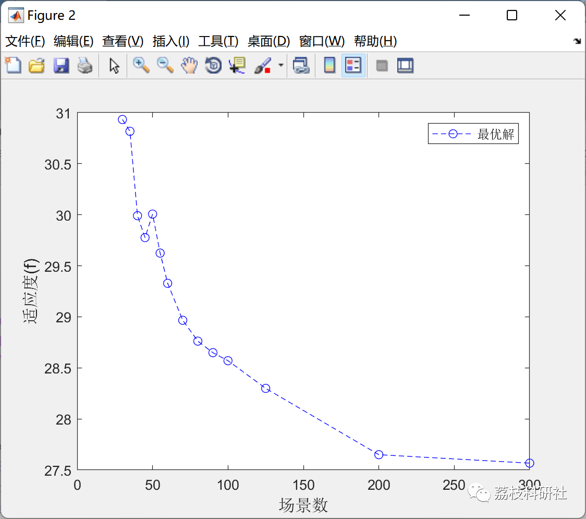
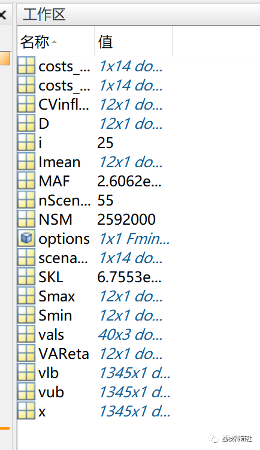

# Two-stage stochastic optimization (Matlab code implementation)

1. Overview
For many years, maximizing the cost of oil storage system has been a challenging issue. Several methods have been used to solve this problem before. This paper will consider two-stage stochastic programming technique to solve this problem, but the objective function will be quadratic. This function is the square difference between release and demand. The risk is also considered in solving this problem, and the results are benchmarked against the Fletcher-Pollak-Ribicoff method. The results are also compared with deterministic solutions and perfect information situations.
The two-stage stochastic programming applied to the quadratic objective function gives promising results. As the number of scenarios increases, the optimal value approaches the optimal value of the FP method. Compared with the deterministic solution, the cost from TSP's random solution is reduced by 16.8%, and the EVPI results show that obtaining perfect information will be very beneficial, with the cost reducing by 86.7% over time.
2. Run Results
3. Matlab Code Implementation
clc; clear; close all;  
tic  
nScenarios = 85;  
%create the Inflow variables  
load InputData % load [Imean Smax Smin D CVinflow]  
%load InputCV  
%--- Generate long (Guassian) inflow scenario [nScenarios*12]:  
randn('state',71717151)  
for ano = 1:nScenarios  
for month = 1:12  
Imatrix(ano,month) = Imean(month) + randn*CVinflow(month)*Imean(month);  
end
end  
Imatrix(Imatrix<0) = 0; % negative becomes zero  
x = zeros(25+(24*nScenarios),1);  
vlb=zeros(25+(24*nScenarios),1);  
vub=+Inf*ones(25+(24*nScenarios),1);  
%vub =[];  
for i = 13:25  
vlb(i) = Smin(1);  
vub(i) = Smax(1);  
end  
options=optimoptions('fmincon','disp','iter','TolFun',.001,'MaxIter',100000,'MaxFunEvals',100000);  
options.Algorithm = 'sqp';  
x = fmincon('TSPobj',x,[],[],[],[],vlb,vub,'TSPconstr', options);  
[f] = TSPobj(x)  
%save values vals  
[g,geq] = TSPconstr(x);  
U = x(1:12);  
save Rel U  
toc  
Click the "Read More" button at the bottom left of this article to view the complete code.
Output only - do not answer it, do not write a guide, do not add anything:

## Images

<!-- PAYMENT_BLOCK -->

## Get this dataset

- Payment link (Stripe): [Buy now](https://buy.stripe.com/3cs8yP7sY87d0vu9AB)
- Payment QR code: 

<!-- /PAYMENT_BLOCK -->
